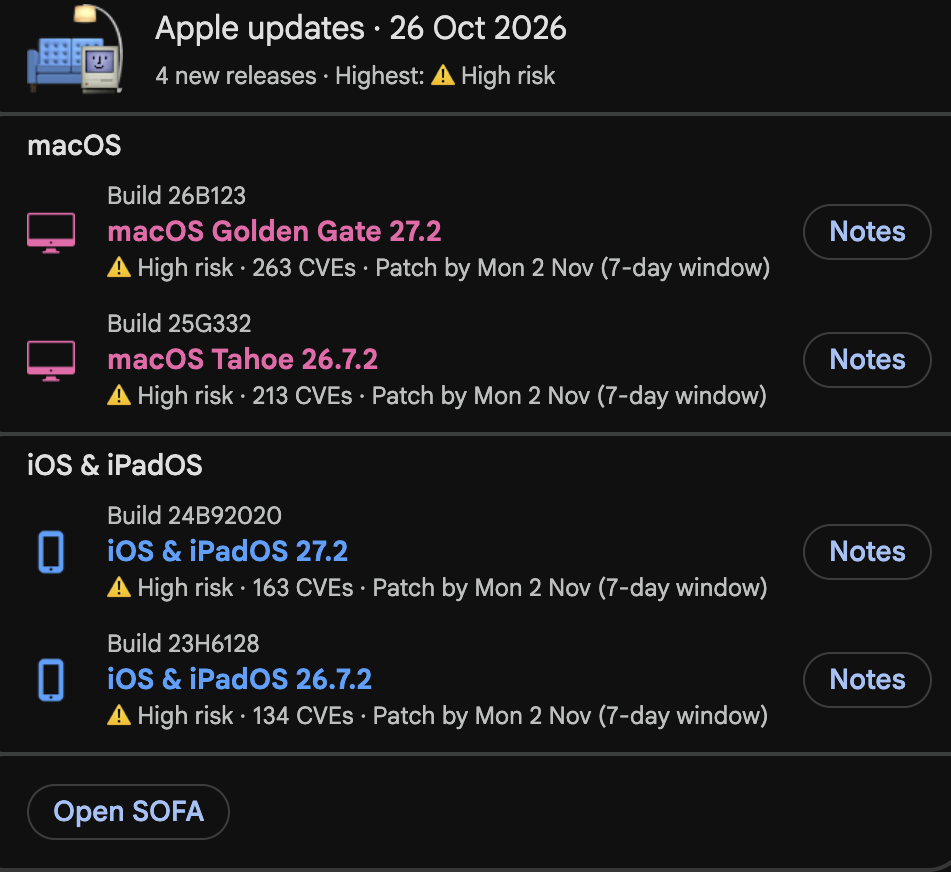
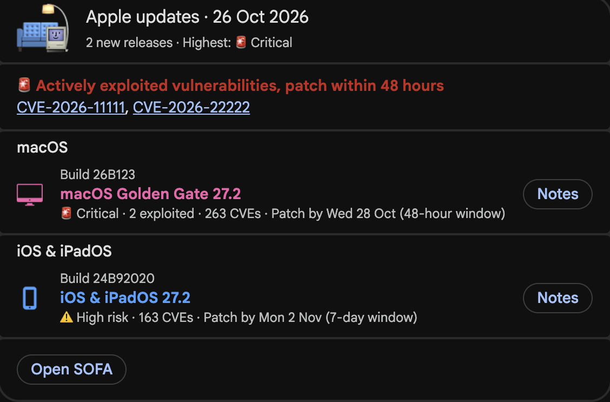

# SOFA Bot 🛋️ 


**SOFA Bot** is a serverless automation tool for the MacAdmins community. It monitors the [SOFA (Simple Organized Feed for Apple)](https://sofa.macadmins.io/) data feed and instantly notifies your team via Google Chat when critical macOS or iOS updates are released.

It is designed to be **"Set and Forget"**—running entirely on GitHub Actions with zero infrastructure costs.

---

## ✨ Key Features

* **🔍 Automated Monitoring:** Checks for updates every 6 hours.
* **🛡️ Smart Security Analysis:**
    * **CRITICAL:** Alerts immediately if "Actively Exploited" vulnerabilities (0-days) are found (48-hour deadline).
    * **High Risk:** Sets a 7-day deadline for updates with >10 CVEs.
    * **Standard:** Sets a 14-day deadline for routine patches.
* **🧹 Noise Reduction:**
    * Monitors the **latest 2 major versions** of macOS and iOS by default, or exactly the versions you pin (e.g. `26,27`).
    * Ignores legacy updates to prevent channel spam.
    * **One message per check:** all new releases are grouped into a single card instead of one message each.
    * **One thread per release day:** if Apple staggers releases across checks, later ones reply in that day's thread.
* **🎨 Rich Notifications:** Posts a Google Chat card with a section per OS, color coding (Pink for macOS, Blue for iOS), a "Patch by" date per release, a red banner with linked CVE IDs for actively exploited vulnerabilities, and deep links to official Apple security release notes.
* **🧠 Stateless Logic:** Uses a separate orphan branch (`bot-state`) to store memory, ensuring the bot never needs admin permissions to push to your protected `main` branch.

---

## 📸 Preview

| Release Day Digest | Critical Alert (0-Day) |
| :---: | :---: |
|  |  |

---

## 🚀 Easy Setup Guide

### 1. Fork & Clone
Fork this repository to your own GitHub account and clone it locally.

### 2. Get Your Webhook
1. Go to the Google Chat space where you want notifications.
2. Click the Space header > **Apps & integrations** > **Manage webhooks**.
3. Create a new webhook and copy the generated URL (it will start with `https://chat.googleapis.com/...`).

### 3. Configure GitHub Secrets
To allow the bot to post to your chat without exposing the URL in code:

1. Go to your forked repository's **Settings**.
2. Select **Secrets and variables** > **Actions** from the sidebar.
3. Click **New repository secret**.
4. Create a secret with these details:
    * **Name:** `CHAT_WEBHOOK_URL`
    * **Secret:** *[Paste the Google Chat Webhook URL you copied in Step 2]*

**Optional: pin the OS versions to watch.** By default the bot watches the newest 2 major versions of macOS and iOS. To watch specific versions instead, open the **Variables** tab (next to Secrets) and add a repository variable:
* **Name:** `MONITORED_MAJORS`
* **Value:** a comma-separated list of major versions, e.g. `26,27`

### 4. Initialize the "Memory" Branch
This bot uses a special orphan branch to store its state file (`last_check.json`). This prevents the bot from spamming your commit history on `main`.

Run these commands in your local terminal inside the project folder:

```bash
# 1. Switch to a new orphan branch (creates a branch with no history)
git checkout --orphan bot-state

# 2. Clear all files from this branch
git rm -rf .

# 3. Create the initial empty state file
echo '{}' > last_check.json

# 4. Commit and push the branch
git add last_check.json
git commit -m "Initial bot state"
git push origin bot-state

# 5. Switch back to main to continue working
git checkout main
```

### 5. Activate the Bot
Go to the **Actions** tab in your GitHub repository.
1. Select **SOFA Update Monitor** on the left.
2. Click **Run workflow** to trigger the first check manually.
3. *Note:* The first run posts one card covering all current versions to "initialize" its memory. Future runs will only post new updates.

---

## 🛠️ How It Works

1.  **Trigger:** GitHub Actions runs the workflow every 6 hours (00:00, 06:00, 12:00, 18:00 UTC).
2.  **State Retrieval:** It checks out the code from `main` and the `last_check.json` file from the `bot-state` branch.
3.  **Analysis:**
    * Fetches live JSON data from `sofa.macadmins.io`.
    * Keeps only the major versions being watched (`MONITORED_MAJORS`, or the newest 2).
    * Compares the live "ProductVersion" against the version stored in `last_check.json`.
4.  **Notification:** If any mismatches are found, it calculates the threat level for each release (CVE counts + Active Exploits) and posts **one** card covering all of them to Google Chat, threaded by release date.
5.  **State Save:** If Chat accepted the post, the script updates `last_check.json` and pushes it back to the `bot-state` branch automatically. If the post failed, the next run retries it.

---

## 📂 Project Structure

```text
sofa-bot/
├── .github/
│   └── workflows/
│       └── run_bot.yml    # The automation schedule
├── sofa_monitor.py        # The core logic script
└── README.md              # This file
```

---

## 🐛 Troubleshooting

**"The workflow failed on the 'cp' command"**
* You likely missed **Step 4** (Initializing the Memory Branch). The workflow expects a `bot-state` branch to exist.

**"I don't see any cards in Google Chat"**
* Check the Action logs. If you see "Chat digest sent", check your Webhook URL.
* If you see `Chat Notification Failed: 400`, the log includes Google's response body. Ensure you haven't modified the JSON payload structure in `sofa_monitor.py` (Google Chat is strict about card widgets).

**"It keeps posting the same update"**
* This means the bot failed to push the updated `last_check.json` back to the repository. Check the "Commit State Changes" step in the Action logs for permission errors.

---

**License**
[MIT](LICENSE)